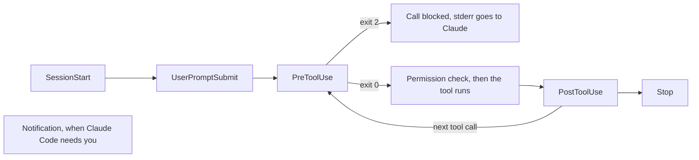

# Закрепляем правило с помощью hook <a id="enforce-a-rule-with-a-hook"></a>

<sub>**Средний уровень** · Урок 5 из 8 · около 20 минут · Нужно: [Разрешения, уровни настроек и песочница](04-permissions-and-sandbox.md) · Проверено на Claude Code v2.1.285 (stable) 2026-10-06</sub>

<a id="goal"></a>
## Цель

После урока вы умеете добавить hook, который обеспечивает выполнение правила при каждой правке файла Claude, и показать, как он срабатывает.

<a id="you-need"></a>
## Что понадобится

- Репозиторий из [урока 4](04-permissions-and-sandbox.md) с его `.claude/settings.json`, а также ваша учебная копия шаблона для практики с Node.js LTS: проверка запускается из копии.
- `jq`, который используют скрипты hooks, и `python3`, который использует `format-after-edit.sh`.
- Расход: небольшой.

<a id="the-idea"></a>
## Идея

Правило в `CLAUDE.md` — это совет, который Claude может пропустить. [Hook](https://code.claude.com/docs/en/hooks-guide) (хук) — это ваша собственная команда, которую Claude Code запускает в определённой точке сессии каждый раз, что бы ни решил Claude. Claude Code передаёт hook на stdin JSON о событии. Hook `PreToolUse` запускается перед вызовом инструмента; если он завершается с кодом 2, вызов блокируется, а то, что он вывел в stderr, уходит Claude как причина ([Hooks reference](https://code.claude.com/docs/en/hooks#exit-code-2-behavior-per-event), [Block edits to protected files](https://code.claude.com/docs/en/hooks-guide#block-edits-to-protected-files)).

Вот события, которые использует этот урок, и их место в ходе:



На схеме: сессия начинается с `SessionStart`; каждый промпт запускает `UserPromptSubmit`; перед каждым вызовом инструмента работает `PreToolUse`, а код выхода 2 блокирует вызов (stderr уходит Claude); после успешного вызова работает `PostToolUse`, затем Claude может вызвать другой инструмент; когда Claude заканчивает ответ, срабатывает `Stop`; `Notification` срабатывает сам, когда Claude Code нужно ваше внимание.

Matcher (сопоставитель) выбирает инструменты, за которыми следит hook: `Edit|Write` запускает его только для этих двух инструментов ([Filter hooks with matchers](https://code.claude.com/docs/en/hooks-guide#filter-hooks-with-matchers)). Hooks `PreToolUse` срабатывают до проверки режима разрешений, поэтому блокировка действует в любом режиме ([Hooks and permission modes](https://code.claude.com/docs/en/hooks-guide#hooks-and-permission-modes)).

<a id="worked-example"></a>
## Разбор на примере

1. В своём репозитории скачайте два из [примеров hooks](../../examples/intermediate/05-hooks/README.md) этого руководства и сделайте их исполняемыми. Прочитайте их, прежде чем использовать:

   ```bash
   mkdir -p .claude/hooks
   for f in protect-files format-after-edit; do
     curl -fsSL "https://raw.githubusercontent.com/wesammustafa/Claude-Code-Everything-You-Need-to-Know/main/examples/intermediate/05-hooks/dot-claude/hooks/$f.sh" -o ".claude/hooks/$f.sh"
   done
   chmod +x .claude/hooks/*.sh
   ```

   `protect-files.sh` — скрипт из руководства по hooks, блокирующий правки `.env`, `package-lock.json` и `.git/`. `format-after-edit.sh` убирает пробелы в конце строк в исходном файле после того, как Claude его отредактировал.
2. Зарегистрируйте их в `.claude/settings.json` рядом с блоком `permissions` из урока 4:

   ```json
   "hooks": {
     "PreToolUse": [
       { "matcher": "Edit|Write", "hooks": [ { "type": "command", "command": "${CLAUDE_PROJECT_DIR}/.claude/hooks/protect-files.sh", "args": [] } ] }
     ],
     "PostToolUse": [
       { "matcher": "Edit|Write", "hooks": [ { "type": "command", "command": "${CLAUDE_PROJECT_DIR}/.claude/hooks/format-after-edit.sh", "args": [] } ] }
     ]
   }
   ```

   При `"args": []` Claude Code запускает скрипт напрямую, без оболочки, поэтому кавычки вокруг пути не нужны ([Exec form and shell form](https://code.claude.com/docs/en/hooks#exec-form-and-shell-form)).
3. Проверьте hook без Claude, подав на вход JSON, который отправил бы вызов Edit. Edit и Write всегда присылают абсолютный путь ([PreToolUse input](https://code.claude.com/docs/en/hooks#pretooluse-input)), поэтому соберите его из `$PWD`:

   ```bash
   echo "{\"tool_input\":{\"file_path\":\"$PWD/package-lock.json\"}}" | .claude/hooks/protect-files.sh; echo "exit $?"
   ```

   Он выводит строку `Blocked:` и `exit 2`.
4. Запустите `claude` и выполните `/hooks`: ваши hooks видны под `PreToolUse` и `PostToolUse` ([Debug your configuration](https://code.claude.com/docs/en/debug-your-config#check-hooks)).
5. Попросите правку, которую hook защищает. В шаблоне для практики `package-lock.json` существует; в своём репозитории назовите защищённый файл, который в нём есть:

   ```text
   Используй инструмент Edit, а не команду оболочки, чтобы изменить version верхнего уровня в package-lock.json на 1.0.1.
   ```

   Edit блокируется: Claude Code передаёт сообщение `Blocked:` вашего скрипта Claude как обратную связь ([Exit code output](https://code.claude.com/docs/en/hooks#exit-code-output)). Здесь назовите инструмент Edit по имени: Claude может отредактировать файл и через команду оболочки, а её hook `Edit|Write` не видит.

<a id="your-turn"></a>
## Ваша очередь

Скрипт из руководства сопоставляет подстроки. Шаблон `*".env"*` блокирует и `.env.example`, который команды коммитят намеренно, и файл вроде `src/config.envelope.ts`; а папку `secrets/` не блокирует ничто. Замените `.claude/hooks/protect-files.sh` этой заготовкой, которая сохраняет блокировки `package-lock.json` и `.git/` из руководства, и доработайте её:

```bash
#!/bin/bash
INPUT=$(cat)
FILE_PATH=$(echo "$INPUT" | jq -r '.tool_input.file_path // empty')
FILE_PATH="${FILE_PATH//\\//}"
NAME=$(basename "$FILE_PATH")

case "/$FILE_PATH" in
  */package-lock.json | */.git/*)
    echo "Blocked: $FILE_PATH is protected" >&2
    exit 2
    ;;
esac

# TODO: block a file named .env, or .env. followed by anything except example
# TODO: block any file inside a secrets/ folder

exit 0
```

Две строки `# TODO` нужно заменить кодом: заблокировать файл с именем `.env` или `.env.` с любым продолжением, кроме `example`, и любой файл внутри папки `secrets/`.

1. Каждая блокировка выводит причину `Blocked:` в stderr и завершается с кодом 2; всё остальное завершается с кодом 0.
2. Запускайте таблицу проверок из раздела «Проверка», пока каждая строка не даст ожидаемый код выхода.
3. В сессии попросите Claude создать `secrets/test.key` инструментом Write. Ваш hook это блокирует.
4. Закоммитьте скрипт и `.claude/settings.json`. Оставьте скрипт исполняемым: `git ls-files -s .claude/hooks/protect-files.sh` начинается с `100755`.

<a id="check"></a>
## Проверка

Урок пройден, когда выполнено всё:

- [ ] Каждый путь даёт ожидаемый код выхода: 2 для `.env`, `config/.env.local`, `secrets/api.key`, `package-lock.json` и `.git/config`; 0 для `.env.example`, `src/config.envelope.ts` и `src/app.js`. Запустите это из корня своего репозитория:

  ```bash
  for p in .env config/.env.local .env.example secrets/api.key src/config.envelope.ts src/app.js package-lock.json .git/config; do
    printf '%s ' "$p"; echo "{\"tool_input\":{\"file_path\":\"$PWD/$p\"}}" | .claude/hooks/protect-files.sh 2>/dev/null; echo $?
  done
  ```

- [ ] Скрипт закоммичен и исполняемый, а закоммиченный `.claude/settings.json` запускает его как hook `PreToolUse` для `Edit|Write`: `git show HEAD:.claude/settings.json | jq .hooks.PreToolUse` его показывает.
- [ ] Самопроверка (не проверяется автоматически): попытка Claude создать `secrets/test.key` была заблокирована вашим сообщением `Blocked:`.

Запустите `npm run check -- i-5 --dir <your repo>` из учебной копии или `npm run check -- i-5` в самой копии.

Если строка в таблице неверна, проверьте этот путь отдельно и выведите имя, которое видит скрипт: `basename` от `.env.local` — это `.env.local`, так что шаблон `case` `.env.*` ему подходит. Проверка запускает закоммиченный скрипт, поэтому коммитьте каждое исправление до запуска. Если второй пункт не прошёл из-за режима файла, выполните `chmod +x .claude/hooks/protect-files.sh`, затем `git add` и закоммитьте снова.

<a id="watch-out"></a>
## Осторожно

- Hooks работают с правами вашего пользователя: в интерактивной сессии — после того, как вы доверили папку, а в запуске `claude -p` — без вопросов ([Workspace trust](https://code.claude.com/docs/en/hooks#workspace-trust)). Читайте hooks репозитория, прежде чем доверять ему или запускать в нём Claude Code из скриптов.
- Hook `Edit|Write` не видит команды оболочки: `echo X >> .env` идёт через Bash. Правила `Read` из урока 4 мешают командам вроде `cat .env` читать эти файлы, но запись вроде этого `>>` проверяется по правилам `Edit`, которых урок 4 не добавляет ([Redirections](https://code.claude.com/docs/en/permissions#redirections)). Для hook, который видит каждое изменение, руководство по hooks добавляет matcher `Bash|PowerShell` или hook `Stop`, сканирующий рабочее дерево ([Filter hooks with matchers](https://code.claude.com/docs/en/hooks-guide#filter-hooks-with-matchers)).
- Hook Notification, например пример [`desktop-notify.sh`](../../examples/intermediate/05-hooks/dot-claude/hooks/desktop-notify.sh), касается вас, а не проекта: руководство по hooks регистрирует свои примеры уведомлений в `~/.claude/settings.json`. Сделайте так же, указав путь к тому месту, где вы храните скрипт.

<a id="go-further"></a>
## Дальше

- [Automate actions with hooks](https://code.claude.com/docs/en/hooks-guide): больше готовых hooks, включая уведомления и повторную подачу контекста после сжатия.
- [Hooks reference](https://code.claude.com/docs/en/hooks): все события, их входные и выходные данные.
- [Debug your configuration](https://code.claude.com/docs/en/debug-your-config#check-hooks): что проверить, если hook не срабатывает.

---

<sub>Источники: [Automate actions with hooks](https://code.claude.com/docs/en/hooks-guide) · [Hooks reference](https://code.claude.com/docs/en/hooks) · [Configure permissions](https://code.claude.com/docs/en/permissions) · [Debug your configuration](https://code.claude.com/docs/en/debug-your-config)</sub>

<sub>← [Разрешения, уровни настроек и песочница](04-permissions-and-sandbox.md) · [Оглавление уровня](README.md) · [Поручаем задачу своему субагенту](06-subagents.md) → · Тема: [Hooks](../topics/hooks.md) · [Застряли на уроке?](https://github.com/runowata/claude-code-ru/issues/new?template=lesson-feedback.yml&lesson=i-5)</sub>
