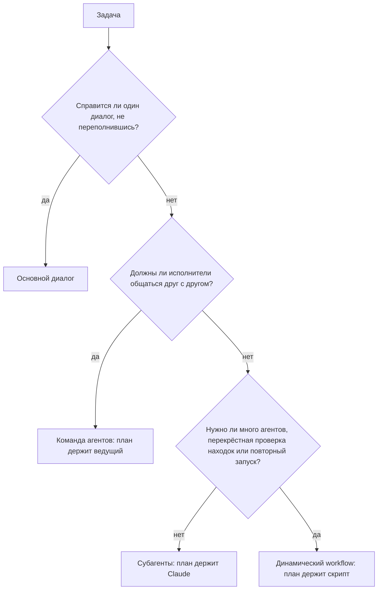

# Выбор схемы оркестрации <a id="choose-an-orchestration-pattern"></a>

<sub>**Продвинутый уровень** · Урок 2 из 7 · около 20 минут · Нужно: [Параллельные сессии с worktrees](01-parallel-sessions.md) · Проверено на Claude Code v2.1.285 (stable) 2026-10-09</sub>

<a id="goal"></a>
## Цель

После урока вы умеете выбирать между основным диалогом, субагентами, динамическим workflow и командой агентов (agent team) по тому, что нужно задаче и во что она обойдётся, и запускать задачу как параллельных субагентов.

<a id="you-need"></a>
## Что понадобится

- Ваш репозиторий из [урока 1](01-parallel-sessions.md), в котором есть как минимум три папки верхнего уровня с файлами, и ваша копия шаблона для практики с Node.js LTS: проверка запускается из копии. Если ещё не сделали, подготовьте папку `.practice/` в репозитории так, как описано в [уроке 1 начального уровня](../beginner/01-install-and-look-around.md#you-need).
- macOS, Linux или WSL 2 и `jq`: журнал делегирования в разделе «Ваша очередь» — это команда оболочки, которая его использует.
- Расход: умеренный. Каждый субагент работает в своём окне контекста и отправляет собственные запросы, которые идут в те же лимиты, что и ваш основной диалог ([Create custom subagents](https://code.claude.com/docs/en/sub-agents)). Для более лёгкого запуска возьмите в разборе на примере две папки, а в задаче 1 — два файла.

<a id="the-idea"></a>
## Идея

Субагенты, динамический workflow и команда агентов делят задачу между исполнителями; различие в том, у кого находится план ([When to use a workflow](https://code.claude.com/docs/en/workflows#when-to-use-a-workflow)). С субагентами Claude решает ход за ходом, и каждый результат возвращается в ваш диалог. Динамический workflow — это скрипт, который пишет Claude: он держит цикл и промежуточные результаты, поэтому может запустить много агентов, сверить их находки и повториться точно так же. В команде агентов ведущий руководит участниками, которые переписываются напрямую ([Choose an approach](https://code.claude.com/docs/en/agents#choose-an-approach)).

Любая схема сложнее одного диалога увеличивает расход: каждый субагент и каждый агент, которого запускает workflow, отправляет собственные запросы ([Why usage climbs](https://code.claude.com/docs/en/costs#why-usage-climbs-in-a-long-session)), а команды агентов «расходуют существенно больше токенов, чем одна сессия» ([When to use agent teams](https://code.claude.com/docs/en/agent-teams#when-to-use-agent-teams)). Поэтому выбирайте самую дешёвую схему, которой хватает для задачи: задавайте эти вопросы по порядку и останавливайтесь на первом ответе, который всё решает.



> [!NOTE]
> «Agent teams are experimental and disabled by default» (команды агентов экспериментальные и по умолчанию выключены). ([Orchestrate teams of Claude Code sessions](https://code.claude.com/docs/en/agent-teams)) Этот урок называет их как один из вариантов и не запускает; запускает дополнительный урок [Agent teams (команды агентов)](electives/agent-teams.md).

<a id="worked-example"></a>
## Разбор на примере

1. Выберите в своём репозитории три папки верхнего уровня, например `src`, `test` и `docs`, и запустите `claude`.
2. Задайте вопросы схемы об одной задаче: краткое описание каждой папки для новичка. Один диалог заполнился бы чтением файлов, которые больше не понадобятся, поэтому не основной диалог ([Choose between subagents and main conversation](https://code.claude.com/docs/en/sub-agents#choose-between-subagents-and-main-conversation)). Описаниям не нужно общаться друг с другом, значит, не команда. Это три задачи, выполняемые один раз, значит, субагенты.
3. Попросите об этом, подставив названия своих папок, как в примере параллельного исследования из документации ([Run parallel research](https://code.claude.com/docs/en/sub-agents#run-parallel-research)):

   ```text
   Исследуй папки src, test и docs параллельно, каждую отдельным субагентом, и дай мне по два предложения о каждой.
   ```

   По умолчанию интерактивная сессия запускает субагентов в фоне, так что строка ввода остаётся свободной ([Run subagents in foreground or background](https://code.claude.com/docs/en/sub-agents#run-subagents-in-foreground-or-background)). Панель под строкой ввода показывает строку для каждого, пока он работает.
4. Пока они работают, выполните `/tasks`. Команда перечисляет каждого субагента с его состоянием и моделью, на которой он работает; Enter на строке открывает его транскрипт ([Check on running work](https://code.claude.com/docs/en/agents#check-on-running-work), [Choose a model](https://code.claude.com/docs/en/sub-agents#choose-a-model)). Claude может запустить [встроенных](https://code.claude.com/docs/en/sub-agents#built-in-subagents) субагентов `Explore` или `general-purpose` либо ответвления вашего диалога (forks), так что ваши строки будут другими. Когда субагент успешно завершается, его строка исчезает из панели, а внизу ненадолго появляется `/tasks to see subagents`; строка субагента, завершившегося с ошибкой, остаётся на некоторое время.
5. Когда итоги придут, выполните `/usage`. На тарифе Pro, Max, Team или Enterprise разбивка расхода относит ваш недавний расход к skills, субагентам, плагинам и MCP-серверам и отмечает действия, например длинный контекст, на которые приходится заметная доля ([Plan usage breakdown](https://code.claude.com/docs/en/costs#plan-usage-breakdown)). Блок Session, рассчитанный на пользователей API, например вошедших через аккаунт Console, показывает оценочную стоимость этой сессии ([Using the `/usage` command](https://code.claude.com/docs/en/costs#using-the-%2Fusage-command)). Обе цифры — оценки.
6. Назовите, что изменило бы ответ. Такое же описание для каждой папки, перепроверяемое и перезапускаемое перед каждым релизом, было бы workflow — схемой следующего урока. Рецензенты, которым нужно между собой выяснить первопричину, были бы командой агентов.

<a id="your-turn"></a>
## Ваша очередь

**Задание:** вот четыре задачи для вашего репозитория. Выберите схему для каждой по тому, что ей нужно и во что она обойдётся, запишите выбор, затем запустите ту задачу, которая требует субагентов.

1. Проверьте три самых больших исходных файла на ошибки, которые перехватываются и игнорируются. Чтение файлов в вашем диалоге его бы переполнило, а нужны только находки: по рецензенту на файл, один раз, и один короткий список в ответ.
2. Выполните ту же проверку для каждого исходного файла, сверьте каждую находку с кодом, прежде чем о ней сообщать, и повторяйте её перед каждым релизом.
3. Исправьте опечатку в одном сообщении об ошибке.
4. Три исследователя проверяют каждый свою версию причины нестабильного теста, переписываются в ходе работы, оспаривая находки друг друга, и продолжают, пока не договорятся о причине.

**Критерии приёмки:**

- В `.practice/a-2-choices.md` по одной строке на задачу вида `<номер задачи>: <схема> because <причина>`, причём каждая схема — это `main conversation`, `subagents`, `workflow` или `agent team`.
- В `.practice/a-2-hook.json` лежит этот [hook `SubagentStart`](https://code.claude.com/docs/en/hooks#subagentstart): при запуске каждого субагента он дописывает его id и тип в `.practice/a-2-agents.txt`, как журнал делегирования в уроке [Поручаем задачу своему субагенту](../intermediate/06-subagents.md):

  ```json
  {
    "hooks": {
      "SubagentStart": [
        { "hooks": [ { "type": "command", "command": "jq -r '[.agent_id, .agent_type] | @tsv' >> \"$CLAUDE_PROJECT_DIR/.practice/a-2-agents.txt\"" } ] }
      ]
    }
  }
  ```

- Задача 1 выполнена как параллельные субагенты, по одному на файл, в сессии, запущенной командой `claude --settings .practice/a-2-hook.json` ([CLI reference](https://code.claude.com/docs/en/cli-reference#cli-flags)).
- Задача 1 не изменила ни одного файла: рецензенты только докладывают, и `git status` не показывает от них никаких изменений.
- Выполнена только задача 1. Остальные три — это выбор схемы.

<a id="check"></a>
## Проверка

Вы закончили, когда выполнено всё из этого списка:

- [ ] В `.practice/a-2-choices.md` для каждой задачи выбрана самая дешёвая подходящая схема.
- [ ] В `.practice/a-2-agents.txt` видно, что для задачи 1 запустились как минимум два субагента: `cut -f1 .practice/a-2-agents.txt | sort -u` выводит два id или больше.
- [ ] Самопроверка (не тестируется): для одной реальной задачи из вашего списка дел вы можете назвать её схему, вопрос, который это решил, и почему более дешёвая схема не подойдёт.

Запустите `npm run check -- a-2 --dir <your repo>` из своей учебной копии.

Если схема для какой-то задачи выбрана неверно, задайте вопросы схемы по порядку: подсказка проверки называет вопрос, который решает эту задачу. Если в журнале меньше двух id, запустите сессию с файлом hook и попросите по одному субагенту на файл, параллельно. Субагент, которого Claude возобновил, пишет свой id в журнал ещё раз, поэтому считается один раз.

<a id="watch-out"></a>
## Осторожно

- Запросы разрешений от фонового субагента появляются в вашей основной сессии, а ответ, действующий дольше одного вызова инструмента, например разрешение до конца сессии, применяется ко всей сессии, включая основной диалог ([Run subagents in foreground or background](https://code.claude.com/docs/en/sub-agents#run-subagents-in-foreground-or-background)). Одобряйте каждый такой запрос только для этого одного вызова, никогда на остаток сессии, и поручайте рецензентам только чтение.
- Результат каждого субагента возвращается в ваш диалог, и каждый субагент тратит собственные токены, пока работает, поэтому много подробных результатов заполняют контекст и увеличивают расход. Просите короткие результаты ([Run parallel research](https://code.claude.com/docs/en/sub-agents#run-parallel-research)).
- Если команды агентов включены, субагент, которого называет Claude, запускается как участник команды, так что команда может сложиться, когда вы просили субагентов. Кроме того, hook записывает строку каждый раз, когда участник, работающий в вашем основном терминале, обрабатывает новое сообщение ([Claude spawns teammates instead of subagents](https://code.claude.com/docs/en/agent-teams#claude-spawns-teammates-instead-of-subagents), [SubagentStart](https://code.claude.com/docs/en/hooks#subagentstart)). Если вы включили команды, добавьте `"env": { "CLAUDE_CODE_EXPERIMENTAL_AGENT_TEAMS": "0" }` в `.practice/a-2-hook.json` ключом верхнего уровня рядом с `"hooks"`. Файл `--settings` переопределяет ваши пользовательские, проектные и локальные настройки и переменную, заданную в оболочке; переопределить его могут только управляемые настройки ([Settings precedence](https://code.claude.com/docs/en/settings#settings-precedence)).

<a id="go-further"></a>
## Дальше

- [Run agents in parallel](https://code.claude.com/docs/en/agents): официальное сравнение способов, которыми Claude Code работает над несколькими задачами одновременно, и как следить за каждым.
- [Fork the current conversation](https://code.claude.com/docs/en/sub-agents#fork-the-current-conversation): субагент, который наследует весь ваш диалог и делит с ним кеш промпта, — для побочной задачи, которой нужен тот же контекст.
- [Agent team token costs](https://code.claude.com/docs/en/costs#agent-team-token-costs): от чего зависит расход команды и как держать его небольшим.

---

<sub>Источники: [Run agents in parallel](https://code.claude.com/docs/en/agents) · [Orchestrate subagents at scale with dynamic workflows](https://code.claude.com/docs/en/workflows) · [Orchestrate teams of Claude Code sessions](https://code.claude.com/docs/en/agent-teams) · [Create custom subagents](https://code.claude.com/docs/en/sub-agents) · [Manage costs effectively](https://code.claude.com/docs/en/costs) · [Hooks reference](https://code.claude.com/docs/en/hooks) · [CLI reference](https://code.claude.com/docs/en/cli-reference) · [Settings files and precedence](https://code.claude.com/docs/en/settings)</sub>

<sub>← [Параллельные сессии с worktrees](01-parallel-sessions.md) · [Оглавление продвинутого уровня](README.md) · [Запуск и сохранение динамического workflow](03-dynamic-workflows.md) → · Тема: [Субагенты и параллельная работа](../topics/subagents-and-parallel-work.md) · [Застряли на уроке?](https://github.com/runowata/claude-code-ru/issues/new?template=lesson-feedback.yml&lesson=a-2)</sub>
