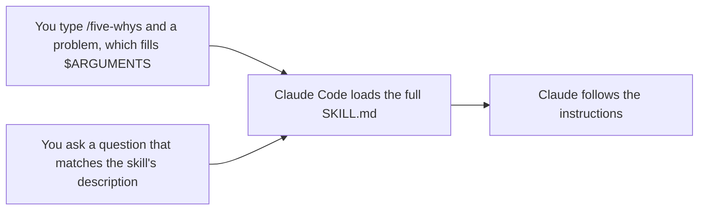

# Превращаем повторяющийся процесс в skill <a id="turn-a-repeated-workflow-into-a-skill"></a>

<sub>**Средний уровень** · Урок 1 из 8 · около 20 минут · Нужно: [оглавление уровня](README.md) · Проверено на Claude Code v2.1.285 (stable) 2026-10-06</sub>

<a id="goal"></a>
## Цель

После урока вы умеете превратить процесс, который вы постоянно повторяете, в проектный skill (навык): он запускается, когда вы вводите его имя, и подгружается сам, когда запрос ему подходит.

<a id="you-need"></a>
## Что понадобится

- Один из ваших репозиториев с командой запуска тестов и без незакоммиченных изменений, а также ваша учебная копия шаблона для практики с Node.js LTS: проверка запускается из копии. Если практикуетесь в самой учебной копии, используйте её для обоих целей. Если вы ещё не сделали этого, подготовьте в репозитории папку `.practice/`, как описано в [уроке 1 начального уровня](../beginner/01-install-and-look-around.md#you-need).
- Расход: от небольшого до умеренного. В разделе «Ваша очередь» вы построите одну небольшую функцию.

> [!NOTE]
> Начиная с этого уровня, уроки написаны для macOS, Linux и WSL 2. В Windows запускайте Claude Code внутри WSL 2 ([Set up on Windows](https://code.claude.com/docs/en/setup#set-up-on-windows)): в родном Windows нет песочницы (sandbox), которую использует урок 4, а hooks в уроке 5 — это bash-скрипты.

<a id="the-idea"></a>
## Идея

[Skill](https://code.claude.com/docs/en/skills) (навык — набор инструкций, который Claude подгружает под задачу) — это папка с файлом `SKILL.md`: YAML-заголовок (frontmatter) сообщает, для чего нужен skill, а затем идут инструкции, которым следует Claude. Проектный skill лежит в `.claude/skills/<name>/SKILL.md`. Закоммитьте его, и он появится у всех, кто работает в репозитории.

Пока skill не запущен, в контексте Claude находится максимум его описание. Запускается он одним из двух способов, и в обоих случаях Claude Code затем загружает файл целиком:



На схеме два пути: вы вводите имя skill и описание проблемы (она попадает в `$ARGUMENTS`) либо задаёте вопрос, подходящий под описание skill. В обоих случаях Claude Code загружает весь `SKILL.md`, и Claude выполняет инструкции.

- Строка `disable-model-invocation: true` в frontmatter оставляет только первый способ. Используйте её для процессов с побочными эффектами, например для выкладки на сервер ([Control who invokes a skill](https://code.claude.com/docs/en/skills#control-who-invokes-a-skill)).
- `$ARGUMENTS` в тексте skill получает всё, что вы вводите после его имени.
- Markdown-файл в `.claude/commands/` — более старый формат; он по-прежнему запускается как `/name`. Для нового лучше выбирать skill.

<a id="worked-example"></a>
## Разбор на примере

1. В своём репозитории создайте папку skill и скачайте пример из этого руководства — [`five-whys`](../../examples/intermediate/01-first-skill/dot-claude/skills/five-whys/SKILL.md). Прочитайте его, прежде чем использовать:

   ```bash
   mkdir -p .claude/skills/five-whys
   curl -fsSL https://raw.githubusercontent.com/wesammustafa/Claude-Code-Everything-You-Need-to-Know/main/examples/intermediate/01-first-skill/dot-claude/skills/five-whys/SKILL.md -o .claude/skills/five-whys/SKILL.md
   ```

   Если не считать строк-комментариев в начале frontmatter, в файле лежит следующее:

   ```markdown
   ---
   name: five-whys
   description: Finds the root cause of a bug, failure or recurring problem by asking "why" until the answer is a cause you can fix. Use when the user asks why something keeps happening, or wants the root cause rather than a quick fix.
   argument-hint: "[problem]"
   ---

   Find the root cause of this problem: $ARGUMENTS
   ```

   Дальше идут пять нумерованных шагов и правило «Don't change any files» (не менять никакие файлы).
2. Запустите `claude` в репозитории и выполните `/skills` ([Commands](https://code.claude.com/docs/en/commands)). В списке есть `five-whys` с пометкой проектного skill.
3. Запустите skill по имени с проблемой из вашего репозитория. В шаблоне для практики:

   ```text
   /five-whys npm run linkcheck -- samples завершается с кодом 1
   ```

   Claude воспроизводит проблему, спрашивает «почему» на основе фактов, пока не дойдёт до причины, которую команда может изменить, а затем сообщает цепочку, первопричину и два варианта исправления. Формулировки будут другими. Во втором терминале `git status` показывает только новые файлы в `.claude/`: skill велел Claude ничего не менять.
4. Выполните `/clear`, затем задайте вопрос, который подходит под описание, не называя skill:

   ```text
   Почему набор тестов проходит, хотя в samples/guide.md есть битая ссылка? Мне нужна первопричина, а не быстрое исправление.
   ```

   Прежде чем Claude ответит, в записи сессии виден вызов инструмента `Skill` для `five-whys`: Claude сам загрузил skill ([Tools reference](https://code.claude.com/docs/en/tools-reference)).

<a id="your-turn"></a>
## Ваша очередь

Доработайте незаконченный skill, который строит функции сначала через тест, и запустите его обоими способами.

1. Скачайте заготовку [skill `tdd`](../../examples/intermediate/01-first-skill/dot-claude/skills/tdd/SKILL.md):

   ```bash
   mkdir -p .claude/skills/tdd
   curl -fsSL https://raw.githubusercontent.com/wesammustafa/Claude-Code-Everything-You-Need-to-Know/main/examples/intermediate/01-first-skill/dot-claude/skills/tdd/SKILL.md -o .claude/skills/tdd/SKILL.md
   ```

   В её frontmatter стоят `description: TODO` и `disable-model-invocation: true`, а шаги заканчиваются так:

   ```markdown
   2. Green: TODO
   3. Refactor: TODO
   ```

2. Доработайте её в редакторе:
   - замените `TODO` в описании одним-двумя предложениями: что делает skill и когда Claude должен его использовать;
   - удалите строку `disable-model-invocation: true`;
   - напишите шаги Green и Refactor в том же стиле, что и шаг Red.
3. Закоммитьте skill: `git add .claude/skills/tdd/SKILL.md`, затем `git commit -m "Add a tdd skill"`.
4. В сессии запустите его по имени на небольшой функции. В шаблоне для практики:

   ```text
   /tdd функция slugify(heading) в src/slug.js, которая превращает заголовок Markdown в якорь ссылки: строчные буквы, без знаков препинания, пробелы заменены дефисами
   ```

   Одобряйте его правки и запуски тестов и разрешите ему закоммитить. Затем сохраните этот коммит: `git rev-parse HEAD > .practice/i-1-commit.txt`.
5. Выполните `/clear` и попросите ещё одну небольшую функцию через тест, не называя skill, например: `Добавь функцию countHeadings(markdown), сначала тест.` Понаблюдайте, как Claude сам запускает `tdd` через инструмент `Skill`. Увидев это, можно нажать `Esc`, чтобы остановить Claude ([Interactive mode](https://code.claude.com/docs/en/interactive-mode)), и выполнить `/rewind`, чтобы отменить его правки ([Checkpointing](https://code.claude.com/docs/en/checkpointing)), как в [уроке 4 начального уровня](../beginner/04-keep-a-session-on-track.md).

<a id="check"></a>
## Проверка

Урок пройден, когда выполнено всё:

- [ ] Готовый skill закоммичен, `TODO` не осталось: `git grep -n TODO HEAD -- .claude/skills/tdd` ничего не выводит.
- [ ] Его можно запустить как `/tdd`, и он подгружается сам: `git show HEAD:.claude/skills/tdd/SKILL.md` показывает описание того, что он делает и когда его использовать, и нет `disable-model-invocation: true`.
- [ ] Коммит, сохранённый в `.practice/i-1-commit.txt`, содержит тест и проверяемый им код: `git show --stat $(cat .practice/i-1-commit.txt)` показывает оба.
- [ ] Самопроверка (не проверяется автоматически): `/tdd` запустил skill, а в очищенной сессии Claude сам загрузил `tdd`.

Запустите `npm run check -- i-1 --dir <your repo>` из учебной копии или `npm run check -- i-1` в самой копии.

Если skill не закоммичен, выполните `git check-ignore -v .claude/skills/tdd/SKILL.md`: правило игнорирования, которое подходит к `.claude`, в `.gitignore`, `.git/info/exclude` или вашем глобальном файле исключений, прячет папку от `git add`; тогда добавьте файл через `git add -f`. Если не прошёл второй пункт, перепишите описание: сначала что делает skill, затем «Use when» и запросы, которым он подходит, — Claude читает только описание, когда решает, загружать ли skill. Если не прошёл пункт про коммит, снова запустите `/tdd` на новой небольшой функции и разрешите ему закоммитить тест вместе с кодом.

<a id="watch-out"></a>
## Осторожно

- Skill может заранее одобрить инструменты через `allowed-tools`, и Claude Code применяет такое разрешение проектного skill даже в запуске `claude -p` в папке, которой вы никогда не доверяли ([Pre-approve tools for a skill](https://code.claude.com/docs/en/skills#pre-approve-tools-for-a-skill)). Читайте skills в репозитории, прежде чем запускать там Claude Code.
- Если папки `.claude/skills/` не было при старте сессии, выполните `/reload-skills`, и только тогда новый skill появится ([Edit a skill during a session](https://code.claude.com/docs/en/skills#live-change-detection)).
- После запуска текст skill остаётся в разговоре, и Claude Code не перечитывает файл. Отредактировав skill, запустите его снова, чтобы Claude получил новую версию ([Skill content lifecycle](https://code.claude.com/docs/en/skills#skill-content-lifecycle)).

<a id="go-further"></a>
## Дальше

- [Introduction to agent skills](https://academy.claude.com/courses/introduction-to-agent-skills): курс Claude Academy о том, как писать skills и делиться ими.
- [Agent Skills](https://agentskills.io): открытый стандарт, которому следуют skills Claude Code; работает и в других ИИ-инструментах.
- [Extend Claude with skills](https://code.claude.com/docs/en/skills): все поля frontmatter, аргументы, вспомогательные файлы и запуск skill в субагенте.

---

<sub>Источники: [Extend Claude with skills](https://code.claude.com/docs/en/skills) · [Advanced setup](https://code.claude.com/docs/en/setup) · [Commands](https://code.claude.com/docs/en/commands) · [Tools reference](https://code.claude.com/docs/en/tools-reference) · [Interactive mode](https://code.claude.com/docs/en/interactive-mode) · [Checkpointing](https://code.claude.com/docs/en/checkpointing)</sub>

<sub>← [Оглавление уровня](README.md) · [Организуем память проекта и смотрим, что загрузилось](02-organize-memory.md) → · Тема: [Skills](../topics/skills.md) · [Застряли на уроке?](https://github.com/runowata/claude-code-ru/issues/new?template=lesson-feedback.yml&lesson=i-1)</sub>
