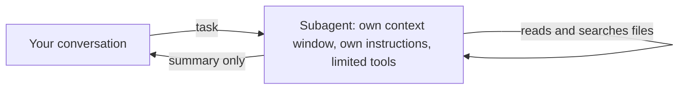

# Поручаем задачу своему субагенту <a id="delegate-to-a-custom-subagent"></a>

<sub>**Средний уровень** · Урок 6 из 8 · около 20 минут · Нужно: [Разрешения, уровни настроек и песочница](04-permissions-and-sandbox.md) · Проверено на Claude Code v2.1.285 (stable) 2026-10-06</sub>

<a id="goal"></a>
## Цель

После урока вы умеете написать субагента, у которого есть только те инструменты, что нужны его задаче, и поручить ему работу.

<a id="you-need"></a>
## Что понадобится

- Один из ваших репозиториев, а также ваша учебная копия шаблона для практики с Node.js LTS: проверка запускается из копии. Если практикуетесь в самой учебной копии, используйте её для обоих целей.
- `jq` — для журнала делегирования в разделе «Ваша очередь».
- Расход: от небольшого до умеренного. Каждое делегирование открывает второе окно контекста.

<a id="the-idea"></a>
## Идея

[Субагент](https://code.claude.com/docs/en/sub-agents) — это отдельный Claude, которому ваша сессия передаёт задачу. Он работает в собственном окне контекста, со своими инструкциями и только с теми инструментами, что вы ему дали, и возвращает краткий итог. Прочитанные им файлы и результаты поиска в ваш разговор не попадают:



На схеме: ваш разговор передаёт задачу субагенту; субагент работает в своём окне контекста, со своими инструкциями и ограниченными инструментами, читает и ищет файлы; в ваш разговор возвращается только его итог.

Проектный субагент — это Markdown-файл в `.claude/agents/`: frontmatter с `name` и `description` (оба обязательны), необязательный список `tools`, затем инструкции, по которым он работает. Claude читает описание, чтобы решить, когда делегировать; субагента можно также назвать в запросе.

Делегируйте задачу, весь вывод которой вам не нужен или которая должна выполняться с ограниченными инструментами. Оставляйте её в основном разговоре, если нужен диалог туда и обратно или если это быстрая точечная правка ([Choose between subagents and main conversation](https://code.claude.com/docs/en/sub-agents#choose-between-subagents-and-main-conversation)).

<a id="worked-example"></a>
## Разбор на примере

1. В своём репозитории скачайте пример из этого руководства — [`code-reviewer`](../../examples/intermediate/06-subagents/dot-claude/agents/code-reviewer.md) — и прочитайте его:

   ```bash
   mkdir -p .claude/agents
   curl -fsSL https://raw.githubusercontent.com/wesammustafa/Claude-Code-Everything-You-Need-to-Know/main/examples/intermediate/06-subagents/dot-claude/agents/code-reviewer.md -o .claude/agents/code-reviewer.md
   ```

   Его frontmatter ограничивает его тремя инструментами: он может читать и искать файлы, но не может их править и запускать команды:

   ```yaml
   name: code-reviewer
   tools: Read, Grep, Glob
   ```

2. Запустите `claude`. Если сессия уже работала, когда вы создали `.claude/agents/`, перезапустите её: Claude Code следит только за теми папками агентов, которые существовали при старте сессии ([Write subagent files](https://code.claude.com/docs/en/sub-agents#write-subagent-files)).
3. Внесите небольшое изменение в исходный файл, затем спросите:

   ```text
   Используй агента code-reviewer, чтобы проверить мои незакоммиченные изменения.
   ```

   Пока он работает, в записи сессии видна строка вроде `code-reviewer(Review uncommitted changes)`. Ревьюер не может выполнить `git diff`, поэтому исходит из сообщения с задачей, которое пишет для него ваша сессия, и снимка состояния git ([What loads at startup](https://code.claude.com/docs/en/sub-agents#what-loads-at-startup)); затем вы получаете его замечания в виде краткого итога, сгруппированные по важности. Формулировки будут другими.

<a id="your-turn"></a>
## Ваша очередь

Доработайте субагента только для чтения, который находит код, не вызываемый ни одним тестом, и поручите ему работу.

1. Сохраните это как `.claude/agents/test-gaps.md` и замените оба `TODO`. Дайте ему только инструменты для чтения:

   ```markdown
   ---
   name: test-gaps
   description: TODO
   tools: TODO
   ---

   You find code that no test exercises. You never change files.

   1. List the functions each source file exports.
   2. For each one, search the test files for a call to it.
   3. Report the functions that no test calls, grouped by file, with one line on what a test for each should check. If every function has a test, say so.
   ```

   В `description` нужно написать, когда его использовать, а в `tools` перечислить инструменты только для чтения.
2. Закоммитьте его.
3. Сохраните этот журнал делегирования в `.practice/i-6-hook.json`. Это [hook на событие `SubagentStart`](https://code.claude.com/docs/en/hooks#subagentstart), который дописывает имя каждого запущенного Claude субагента в `.practice/i-6-agents.txt` и больше ничего не записывает:

   ```json
   {
     "hooks": {
       "SubagentStart": [
         { "hooks": [ { "type": "command", "command": "jq -r '.agent_type' >> \"$CLAUDE_PROJECT_DIR/.practice/i-6-agents.txt\"" } ] }
       ]
     }
   }
   ```

4. Запустите `claude --settings .practice/i-6-hook.json` и попросите: `Используй агента test-gaps, чтобы перечислить функции, которые не вызывает ни один тест.`

<a id="check"></a>
## Проверка

Урок пройден, когда выполнено всё:

- [ ] В закоммиченном субагенте есть имя и описание того, когда его использовать: `git show HEAD:.claude/agents/test-gaps.md | head -5`.
- [ ] Его инструменты только для чтения: в строке `tools` названы инструменты вроде `Read`, `Grep` и `Glob` и нет ни одного инструмента, который правит файлы или запускает команды, например `Edit`, `Write` или `Bash`.
- [ ] Claude делегировал ему работу: `grep -x test-gaps .practice/i-6-agents.txt` выводит `test-gaps`.
- [ ] Самопроверка (не проверяется автоматически): прочитанные субагентом файлы остались вне вашего разговора, а вернулся только его итог.

Запустите `npm run check -- i-6 --dir <your repo>` из учебной копии или `npm run check -- i-6` в самой копии.

Если не прошёл первый пункт, проверьте frontmatter: Claude Code пропускает файл агента без `name` и файл с `name`, но без `description`. Если не прошёл пункт про инструменты, уберите каждый инструмент, который может менять файлы или запускать команды; без строки `tools` субагент получает все инструменты. Если в журнале нет строки `test-gaps`, запустите сессию с файлом hook и назовите субагента в запросе.

<a id="watch-out"></a>
## Осторожно

- Субагент, у которого в списке есть `Bash`, всё равно может менять файлы через команды оболочки, например правкой `sed` или [перенаправлением `> file`](https://code.claude.com/docs/en/permissions#redirections), даже без `Edit` и `Write`. Не включайте `Bash` и пусть ваша сессия передаёт ему то, что показала бы команда.
- В macOS, Linux и WSL, где Glob и Grep по умолчанию отсутствуют, субагент, в списке `tools` которого названы `Glob` или `Grep`, а `Bash` нет, получает те инструменты, что названы ([Glob tool behavior](https://code.claude.com/docs/en/tools-reference#glob-tool-behavior)).
- Собственный субагент читает ваш `CLAUDE.md` так же, как основной разговор, а встроенные субагенты Explore и Plan его пропускают: повторите правило в запросе, когда Claude передаёт им работу ([Check common causes](https://code.claude.com/docs/en/debug-your-config#check-common-causes)).

<a id="go-further"></a>
## Дальше

- [Introduction to subagents](https://academy.claude.com/courses/introduction-to-subagents): курс Claude Academy о проектировании и использовании субагентов.
- [How and when to use subagents in Claude Code](https://claude.com/blog/subagents-in-claude-code): Anthropic о том, когда делегировать, а когда оставаться в основной сессии.
- [Create custom subagents](https://code.claude.com/docs/en/sub-agents): все поля frontmatter, фоновые субагенты и возобновление субагента.

---

<sub>Источники: [Create custom subagents](https://code.claude.com/docs/en/sub-agents) · [Hooks reference](https://code.claude.com/docs/en/hooks) · [Tools reference](https://code.claude.com/docs/en/tools-reference) · [Configure permissions](https://code.claude.com/docs/en/permissions) · [Debug your configuration](https://code.claude.com/docs/en/debug-your-config)</sub>

<sub>← [Закрепляем правило с помощью hook](05-hooks.md) · [Оглавление уровня](README.md) · [Подключаем инструмент через MCP](07-mcp.md) → · Тема: [Субагенты и параллельная работа](../topics/subagents-and-parallel-work.md) · [Застряли на уроке?](https://github.com/runowata/claude-code-ru/issues/new?template=lesson-feedback.yml&lesson=i-6)</sub>
