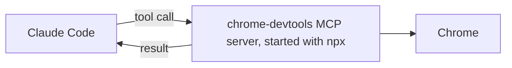

# Подключаем инструмент через MCP <a id="connect-a-tool-with-mcp"></a>

<sub>**Средний уровень** · Урок 7 из 8 · около 20 минут · Нужно: [Разрешения, уровни настроек и песочница](04-permissions-and-sandbox.md) · Проверено на Claude Code v2.1.285 (stable) 2026-10-06</sub>

<a id="goal"></a>
## Цель

После урока вы умеете подключить MCP-сервер для себя, а затем поделиться им со всеми в проекте на уровне проекта, закрепив одну версию.

<a id="you-need"></a>
## Что понадобится

- Один из ваших репозиториев, а также ваша учебная копия шаблона для практики с Node.js LTS: проверка запускается из копии. Если практикуетесь в самой учебной копии, используйте её для обоих целей. Если вы ещё не сделали этого, подготовьте в репозитории папку `.practice/`, как описано в [уроке 1 начального уровня](../beginner/01-install-and-look-around.md#you-need).
- Chrome и npm, который идёт вместе с Node.js: сервер запускается через `npx` ([upstream requirements](https://github.com/ChromeDevTools/chrome-devtools-mcp/blob/chrome-devtools-mcp-v1.10.1/README.md#requirements)).
- Расход: небольшой.

<a id="the-idea"></a>
## Идея

[MCP](https://code.claude.com/docs/en/mcp) (Model Context Protocol, протокол контекста модели) позволяет Claude Code использовать инструменты, которые предоставляет другая программа, — MCP-сервер. Сервер этого урока — [Chrome DevTools MCP](https://github.com/ChromeDevTools/chrome-devtools-mcp) (Vendor: Google, то есть от самого вендора). Он работает на вашей машине и даёт Claude инструменты, чтобы открывать страницы в Chrome, читать консоль и делать скриншоты:



На схеме: Claude Code вызывает инструменты MCP-сервера chrome-devtools; сервер — локальный процесс, запущенный через `npx`, — управляет браузером Chrome и возвращает результаты в Claude Code.

То, где вы добавляете сервер, определяет, у кого он будет ([MCP installation scopes](https://code.claude.com/docs/en/mcp#mcp-installation-scopes)):

| Уровень | У кого есть | Где хранится |
|---|---|---|
| Local (локальный), по умолчанию | У вас, в этом проекте | `~/.claude.json` |
| Project (проект) | У всех, кто работает в проекте | `.mcp.json` в корне проекта, коммитится |
| User (пользователь) | У вас, во всех проектах | `~/.claude.json` |

В интерактивной сессии Claude Code просит вас одобрить серверы проекта, прежде чем их использовать.

> [!WARNING]
> Данные, которые покидают вашу машину. По умолчанию Chrome DevTools MCP отправляет статистику использования в Google, может отправлять URL трассировок производительности в Google CrUX API и проверяет в npm наличие обновлений ([upstream README](https://github.com/ChromeDevTools/chrome-devtools-mcp/blob/chrome-devtools-mcp-v1.10.1/README.md)). В этом уроке он всегда запускается с тремя выключенными функциями. Страницы, которые открывает Claude, по-прежнему загружаются из сети, а сервер показывает Claude всё, что есть в этом браузере.

<a id="worked-example"></a>
## Разбор на примере

1. Сохраните страницу для просмотра в своём репозитории:

   ```bash
   cat > .practice/demo.html <<'EOF'
   <!doctype html>
   <title>Linkcheck demo</title>
   <h1>Linkcheck demo</h1>
   <script>console.warn('demo warning from the page');</script>
   EOF
   ```

2. Добавьте сервер на локальном уровне, для себя. Версия закреплена, `--isolated` даёт браузеру временный профиль, а два других флага и переменная выключают потоки данных ([configuration](https://github.com/ChromeDevTools/chrome-devtools-mcp/blob/chrome-devtools-mcp-v1.10.1/docs/configuration.md)). Всё после `--` — собственная команда сервера:

   ```bash
   claude mcp add --env CHROME_DEVTOOLS_MCP_NO_UPDATE_CHECKS=1 --transport stdio chrome-devtools -- npx -y chrome-devtools-mcp@1.10.1 --isolated --no-usage-statistics --no-performance-crux
   ```

3. Выполните `claude mcp get chrome-devtools`. Команда показывает, на каком уровне хранится сервер (здесь local), и состояние сервера ([Find your configuration on disk](https://code.claude.com/docs/en/mcp-quickstart#find-your-configuration-on-disk)).
4. Запустите `claude` и выполните `/mcp`: `chrome-devtools` в списке вместе со своими инструментами. Затем попросите:

   ```text
   Используй инструменты chrome-devtools, чтобы открыть .practice/demo.html как URL file:, и скажи мне его заголовок и сообщения консоли.
   ```

   Открывается окно Chrome, и Claude сообщает заголовок `Linkcheck demo` и предупреждение консоли. В режиме Manual Claude Code запрашивает разрешение при первом использовании Claude каждого инструмента ([Configure permissions](https://code.claude.com/docs/en/permissions#permission-modes)).

<a id="your-turn"></a>
## Ваша очередь

Поделитесь сервером с командой на уровне проекта.

1. Удалите свою локальную копию: иначе она имела бы приоритет над серверами проекта с тем же именем: `claude mcp remove chrome-devtools -s local`.
2. Сохраните этот частичный файл как `.mcp.json` в корне репозитория и замените каждый `TODO` значениями из команды разбора на примере:

   ```json
   {
     "mcpServers": {
       "chrome-devtools": {
         "type": "stdio",
         "command": "npx",
         "args": ["-y", "TODO: the package at an exact version", "--isolated", "TODO: no usage statistics", "TODO: no CrUX lookups"],
         "env": { "TODO: the variable that turns off update checks": "1" }
       }
     }
   }
   ```

   Вместо `TODO` нужны: пакет с точной версией, флаг отключения статистики использования, флаг отключения обращений к CrUX и переменная, выключающая проверку обновлений.
3. Закоммитьте `.mcp.json`.
4. Запустите `claude`. Когда он спросит про новый MCP-сервер, найденный в этом проекте, выберите его использовать. Теперь `/mcp` показывает его как подключённый ([Edit .mcp.json directly](https://code.claude.com/docs/en/mcp-quickstart#edit-mcp-json-directly)).
5. Попросите Claude использовать инструменты chrome-devtools, чтобы открыть `.practice/demo.html` и сохранить его скриншот в `.practice/i-7-page.png`.

<a id="check"></a>
## Проверка

Урок пройден, когда выполнено всё:

- [ ] В закоммиченном `.mcp.json` пакет закреплён на точной версии, а статистика использования, обращения к CrUX и проверка обновлений выключены: `git show HEAD:.mcp.json | jq '.mcpServers["chrome-devtools"]'` их показывает.
- [ ] Сервер сохранил скриншот: `file .practice/i-7-page.png` сообщает PNG image data.
- [ ] Самопроверка (не проверяется автоматически): после вашего одобрения `/mcp` показал `chrome-devtools` как подключённый.

Запустите `npm run check -- i-7 --dir <your repo>` из учебной копии или `npm run check -- i-7` в самой копии.

Если не прошёл первый пункт, сверьте каждый аргумент с командой разбора на примере: `@latest` — это не закреплённая версия. Если скриншота нет, выполните `/mcp` и посмотрите, подключился ли сервер. Если вы пропустили запрос на одобрение, одобрите сервер там; если вы отказали, выполните `claude mcp reset-project-choices` и снова запустите `claude` ([Project scope](https://code.claude.com/docs/en/mcp#project-scope)).

<a id="watch-out"></a>
## Осторожно

- Запуск `claude -p` загружает серверы проекта, не спрашивая ([Project scope](https://code.claude.com/docs/en/mcp#project-scope)). Читайте `.mcp.json` репозитория, прежде чем запускать в нём Claude Code из скриптов.
- Чтобы вас снова спросили о серверах проекта, выполните `claude mcp reset-project-choices`.

Сторонний продукт: он может выполнять код на вашей машине или давать Claude новые инструменты. Просмотрите его перед установкой; это руководство его не проверяет.

Списки проверены по планке для списков 2026-10-06.

<a id="go-further"></a>
## Дальше

- [Connect to MCP servers](https://code.claude.com/docs/en/mcp-quickstart): добавление удалённых серверов, вход в них и другие способы добавить сервер.
- [The MCP Registry](https://registry.modelcontextprotocol.io): список публичных серверов проекта MCP, который он помечает как «preview» (предварительная версия) ([About](https://modelcontextprotocol.io/registry/about)).
- [What is the Model Context Protocol (MCP)?](https://modelcontextprotocol.io/docs/getting-started/intro): сам протокол.

---

<sub>Источники: [Connect Claude Code to tools via MCP](https://code.claude.com/docs/en/mcp) · [Connect to MCP servers](https://code.claude.com/docs/en/mcp-quickstart) · [Configure permissions](https://code.claude.com/docs/en/permissions) · [Chrome DevTools MCP README](https://github.com/ChromeDevTools/chrome-devtools-mcp/blob/chrome-devtools-mcp-v1.10.1/README.md) · [Chrome DevTools MCP configuration](https://github.com/ChromeDevTools/chrome-devtools-mcp/blob/chrome-devtools-mcp-v1.10.1/docs/configuration.md) · [The MCP Registry](https://modelcontextprotocol.io/registry/about)</sub>

<sub>← [Поручаем задачу своему субагенту](06-subagents.md) · [Оглавление уровня](README.md) · [Устанавливаем плагины и управляем ими](08-plugins.md) → · Тема: [MCP](../topics/mcp.md) · [Застряли на уроке?](https://github.com/runowata/claude-code-ru/issues/new?template=lesson-feedback.yml&lesson=i-7)</sub>
